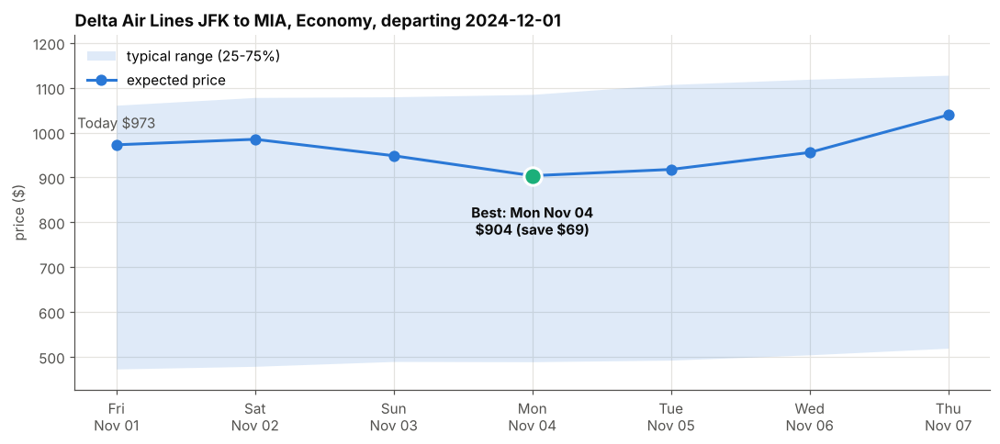
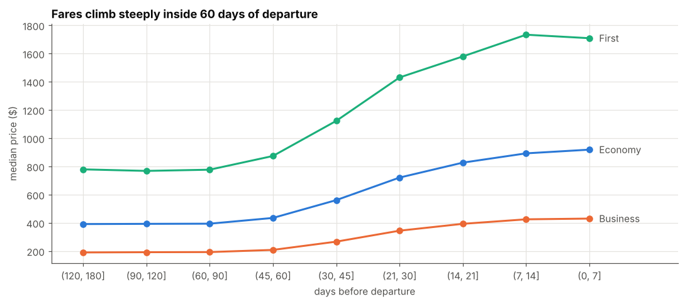
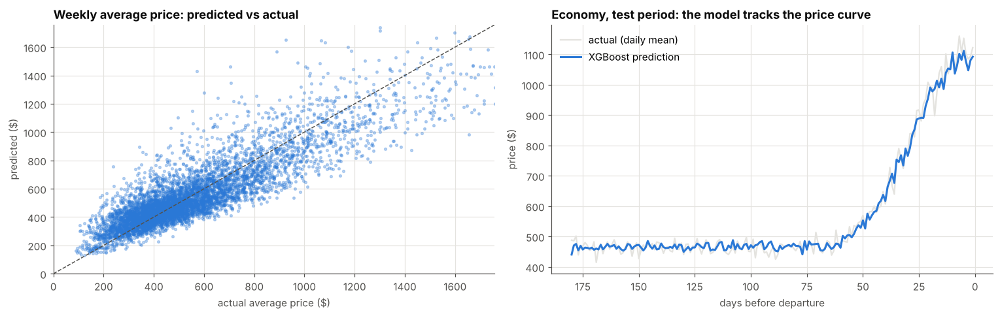
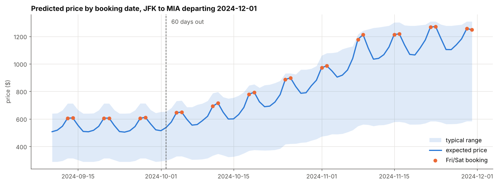
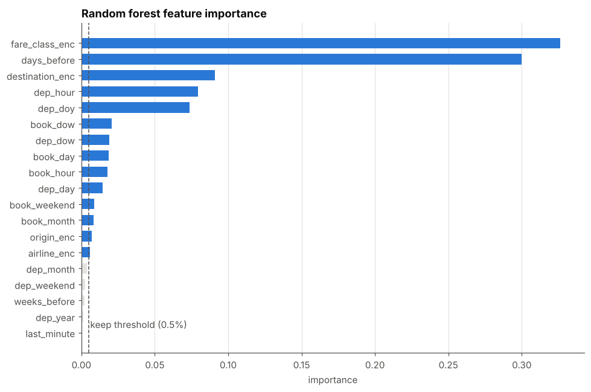
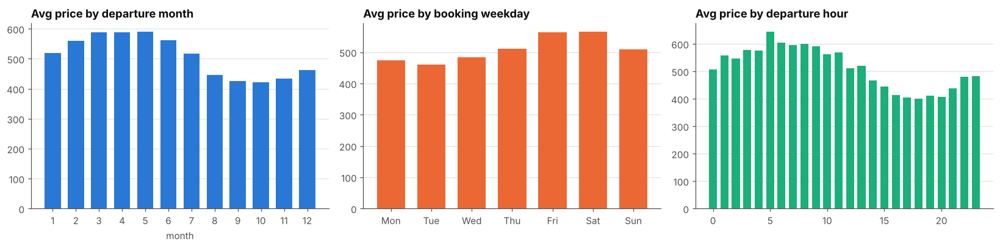

# ✈️ Google Flights Airfare Forecast and "Best Day to Book" Calendar

Predicting airline ticket prices from booking time, then using the model to tell travellers **which day to book** and **how much they would save**.



> *Example: a traveller searching on Nov 1 for a Dec 1 Delta flight from JFK to Miami. The calendar recommends waiting until Monday Nov 4 and saving about **$69 (7%)**.*

---

## 📌 Business problem

Google Flights users often ask *"when is the best time to book?"*. The product team wants an **Interactive Calendar** that shows the forecasted price for each possible booking date, so users can pick the cheapest one.

This project delivers the two pieces that feature needs:

1. **A price model** that predicts the ticket price for a flight given its booking date, route, airline, fare class and departure date.
2. **A scenario ("what-if") tool** that runs the model over a window of booking dates (e.g. the next 7 days), finds the cheapest day and shows the saving versus booking today.

## 📊 Results at a glance

| Metric | Result |
|---|---|
| Model accuracy on weekly average prices (2024 test flights) | **R² 0.77**, MAPE 20% (simple rule: R² 0.51, MAPE 25%) |
| Model accuracy on single tickets | R² 0.50, MAPE 51% (simple rule: R² 0.38, MAPE 53%) |
| Backtest: average saving from following the calendar (3,230 real searches) | **$31 per ticket (5.6%)** |
| Calendar's pick beats a random day in the same week | **59%** of searches |

Single tickets are very noisy (the same flight in the same week can vary by about 42%), so the calendar shows the **expected** price with a typical 25 to 75% range, where the model is accurate.

## 💡 Key insights for travellers

1. **Book 60 or more days ahead.** Prices are flat from 180 to about 60 days out, then roughly **double** inside 30 days.
2. **Book Monday to Wednesday, not Friday or Saturday.** Weekend bookings cost about 15 to 20% more.
3. **Seasonality matters.** February to June departures are the most expensive; August to November the cheapest.
4. **Close to departure, book now.** Waiting usually costs more, and the calendar says so.



---

## 🛠️ What I did, step by step

| Step | What I did | Why |
|---|---|---|
| **1. Problem definition** | Framed the task as regression on ticket price plus a "what-if" simulation over booking dates. | Matches the Interactive Calendar feature. |
| **2. Exploratory data analysis** | Explored 225,209 bookings (3 airlines, 25 routes, 3 fare classes, Apr 2022 to Sep 2024). Checked data quality, distributions and what drives price. | Found that lead time, fare class, booking weekday, season and destination drive price; prices are right-skewed and noisy. |
| **3. Data preparation** | Parsed dates, label-encoded categories, and split the data **chronologically** (train before Oct 2023, validation Oct 2023 to Feb 2024, test Mar to Sep 2024). | A time-based split mimics real use (always predicting future flights) and avoids leakage. |
| **4. Feature engineering** | Built `days_before`, `weeks_before`, `last_minute`, and booking/departure parts (weekday, hour, month, day of year, weekend flags) in one reusable `add_features()` function. | The same function feeds training and the scenario tool, so inputs always match. |
| **5. Feature selection** | Ranked features with a random forest and kept those above 0.5% importance (plus the inputs a user picks). Dropped `dep_year`. | Tree models cannot extrapolate to unseen years; fewer features reduce overfitting. |
| **6. Modelling** | Trained **XGBoost on log(price)**, tuned with random search on the validation set, refit on train + validation, applied a smearing correction (median → mean price), and trained quantile models for a 25 to 75% price range. | XGBoost is strong on tabular data; log space handles skew and multiplicative pricing effects. |
| **7. Evaluation** | Compared against a "business rule" benchmark (median price for the same route, fare class and weeks before departure) using MAPE, MAE, RMSE and R². Checked every subgroup for Simpson's paradox. | The model beats the benchmark overall **and** in every fare class and lead-time bucket. |
| **8. Scenario planning** | Built `predict_booking_calendar()`, `plot_booking_calendar()` and `booking_advice()`, ran example scenarios, and **backtested** the advice on real 2024 bookings. | Proves real user savings, not just model accuracy. |

A section-by-section walkthrough of the notebook is in [docs/Notebook_Explained.md](docs/Notebook_Explained.md).

### How it fits together

```
Raw bookings ──► Clean & format ──► Features (days_before, weekday, season...)
                                          │
                       ┌──────────────────┴──────────────────┐
                       ▼                                     ▼
          XGBoost (log price)                    Quantile XGBoost (range)
                       │                                     │
                       └───────────► Scenario tool ◄─────────┘
                                         │
              User picks route + dates ──┘──► Price per booking day
                                              Best day + saving
```

### More visuals

| Predicted vs actual (test period) | Full booking calendar |
|---|---|
|  |  |

| Feature importance | Seasonality and booking weekday |
|---|---|
|  |  |

---

## 📁 Repository structure

```
.
├── Google_Flights_Airfare_Forecast.ipynb   # Full analysis, model and scenario tool
├── docs/
│   └── Notebook_Explained.md               # Section-by-section explanation
├── images/                                 # Charts used in this README
├── data/
│   └── README.md                           # Where to put the dataset
├── requirements.txt
└── README.md
```

## ▶️ How to run

```bash
git clone https://github.com/harshada-terwadkar/analytics-engineering-projects.git
cd analytics-engineering-projects/projects/Google-flights-airfare-forecast
python -m venv .venv
source .venv/bin/activate        # Windows: .venv\Scripts\activate
pip install -r requirements.txt
# put google_flights_airfare_data.csv in the data/ folder (see data/README.md)
jupyter notebook Google_Flights_Airfare_Forecast.ipynb
```

You can also open the notebook in Google Colab and upload the CSV to `data/`.

## ⚠️ Limitations and next steps

- The data is **simulated**. For example, Business fares are cheaper than Economy, which should be confirmed with the data owner.
- The calendar shows expected prices and a range, not a guarantee.
- Dates after September 2024 are outside the training data; the model assumes seasonal and lead-time patterns hold.
- Next: retrain regularly on fresh data, add holiday and event features, and A/B test the calendar on booking conversion and user savings.

## 🧰 Tech stack

Python · pandas · NumPy · scikit-learn · XGBoost · Matplotlib · Jupyter
