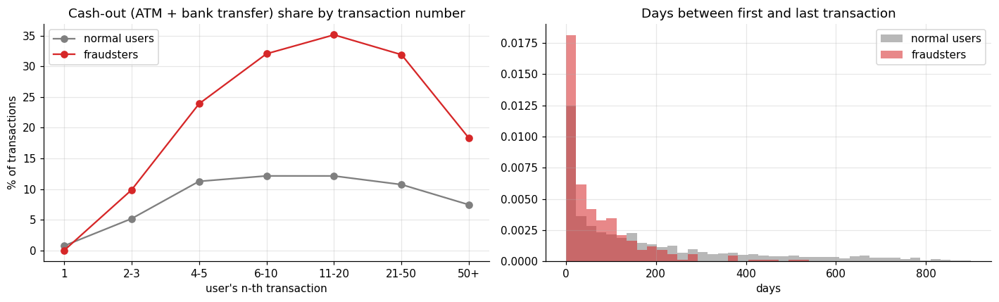
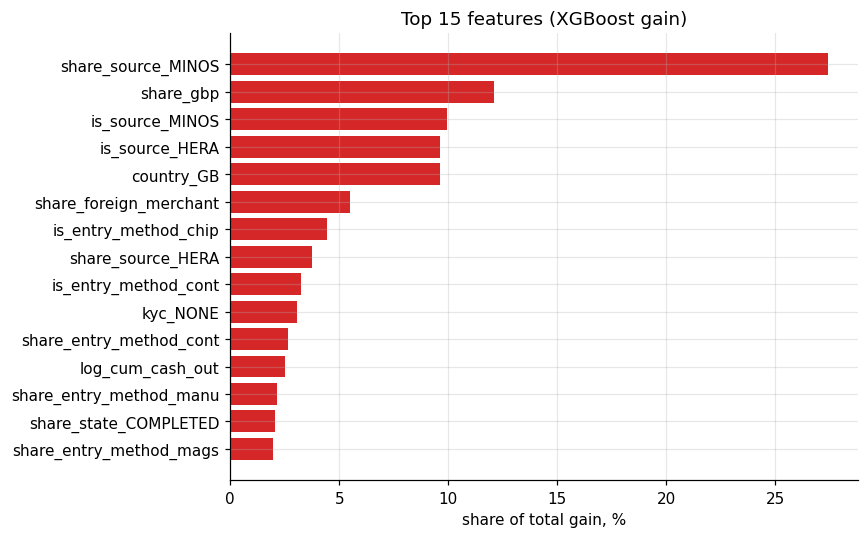
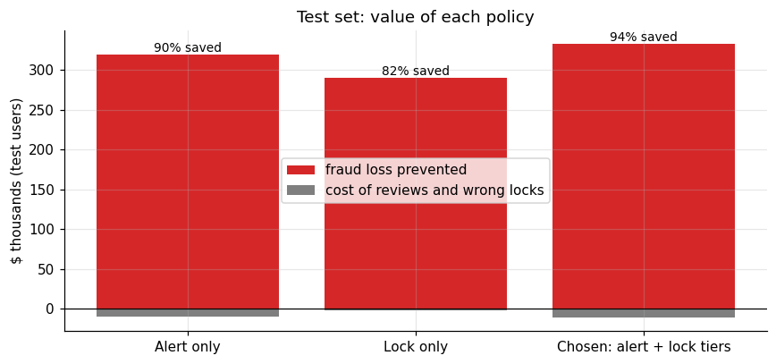
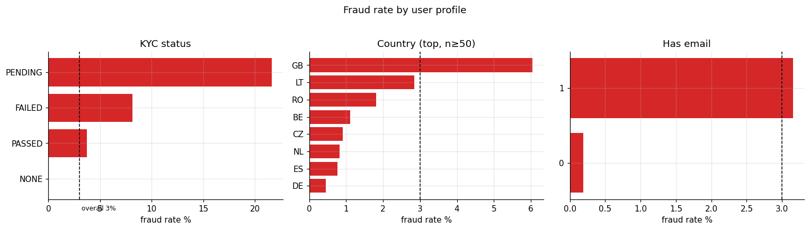
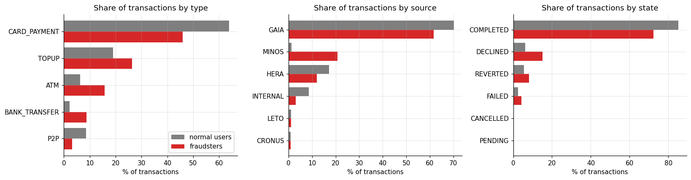
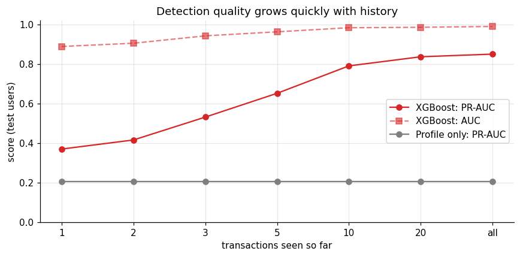
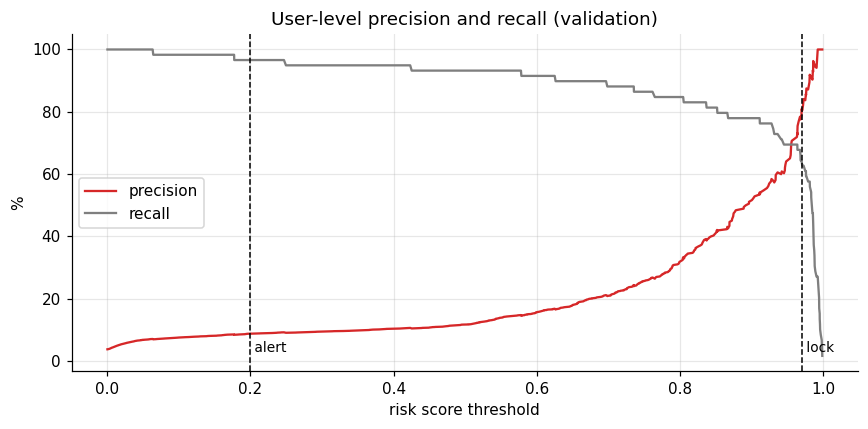

# 🛡️ PayPal Fraud Detection: catching fraudsters early

Identifying users who signed up only to steal money — as early in their account life as possible — and deciding what to do: lock the account, send it to a human agent, or both.



> *Fraudsters flip from topping up to cashing out between their 5th and 10th transaction, and close their accounts within 38 days on average. The model can flag them before that window closes.*

---

## 📌 Business problem

PayPal faces fraudsters who fund a new account, drain other users' money via ATM withdrawals, bank transfers or card payments, then disappear. Every flag triggers a manual review, and every false positive disturbs a genuine customer. The goal is to find the right balance: catch fraud early, spend as few review hours as possible, and almost never lock a good user without warning.

---

## 📊 Results at a glance

| Metric | Result |
|---|---|
| User-level AUC (test) | **0.990** |
| User-level PR-AUC (test) | **0.850** |
| Fraudsters caught | **100%** (of test fraudsters, with chosen thresholds) |
| Fraud loss prevented | **$332,572 of $355,392 (94%)** |
| Alert precision | 9% (1 in 11 alerts is a confirmed fraudster) |
| Good users wrongly locked | **12 of 1,490** (0.8%) |
| Agent reviews triggered | 651 (for 1,550 test users) |
| **Net value vs. no model** | **+$321,607** (test set) |

Detection quality by number of transactions seen:

| After n transactions | AUC | PR-AUC |
|---|---|---|
| 1 | 0.889 | 0.370 |
| 3 | 0.942 | 0.532 |
| 5 | 0.963 | 0.652 |
| 10 | 0.983 | 0.791 |
| all | 0.990 | 0.850 |

The model is already meaningful after the 1st transaction (profile alone) and strong by the 5th.

---

## 💡 Key findings

1. **Who fraudsters are:** 6% of GB accounts are fraudsters, vs. under 1% for most of Europe. KYC PENDING users have a 22% fraud rate; KYC FAILED is 8%. The profile alone predicts well at sign-up.
2. **What fraudsters do:** 92% of their transactions are in GBP. They use bank transfers 4× more and ATM withdrawals 2.5× more than normal users. Their transactions are declined 2.4× more often.
3. **The MINOS pipeline** handles 21% of fraudster transactions but only 1% of normal ones — a 17× lift. It is a specific funding / transfer channel fraudsters prefer.
4. **Fast life cycle:** fraudsters start cashing out within 5–10 transactions, and their accounts last a median of 38 days vs. 99 for normal users.
5. **Top features (by model gain):** share of transactions through MINOS, share in GBP, GB country flag, HERA source, foreign merchants, KYC status, ATM usage, manual card entry.



---

## 🛠️ What I did, step by step

| Step | What I did | Why |
|---|---|---|
| **1. Problem framing** | Modelled as *real-time user scoring*: after each transaction, compute a risk score from the user's profile and everything that has happened so far. | Fraud is labelled per user, not per transaction. Scoring after each event lets us catch fraudsters mid-way. |
| **2. Data audit** | Found that `amount_usd` is in cents, crypto amounts are unconverted (up to $10 trillion), 2,196 users have no transactions, and recent cohorts are under-labelled (fraud not yet discovered). | Informed safe cleaning decisions and a strict no-leakage policy. |
| **3. EDA** | Compared fraud rates across country, KYC, source, type, entry method, and transaction sequence. | Identified the strongest signals: MINOS, GBP, GB, KYC, bank-transfer and ATM usage. |
| **4. Feature engineering** | Built 50+ features: user profile (10), per-transaction indicators, and running shares / cumulative amounts per user history. Every feature at transaction n uses only transactions 1–n. | Running features capture behavioural drift without future leakage. |
| **5. Model comparison** | Benchmarked an analyst rule, profile-only logistic regression, all-features logistic regression, and XGBoost with random-search tuning. | Shows the real value of transaction history vs. profile alone. |
| **6. Early detection** | Scored users after 1, 2, 3, 5, 10, 20 and all transactions. | Proves the model is actionable early, when it still matters. |
| **7. Business simulation** | Replayed test users in time order with two thresholds: alert (score ≥ 0.2) and lock (score ≥ 0.97). Counted fraud prevented, reviews needed, and good users disturbed. | Connects model accuracy to dollars and operational load. |
| **8. Operational policy** | Wrote `patrol(user_id)` that returns `['LOCK_USER', 'ALERT_AGENT']`, `['ALERT_AGENT']`, or `[]` based on the live risk score. | A drop-in function ready to plug into a transaction monitoring system. |

---

## 🔍 How the policy works

| Score | Action | Reasoning |
|---|---|---|
| ≥ 0.97 | **LOCK_USER + ALERT_AGENT** | Very high confidence: block immediately, alert agent so a wrongly-locked genuine user gets unlocked fast. |
| ≥ 0.2 | **ALERT_AGENT** | Suspicious but uncertain: let the transaction through, agent reviews and locks if confirmed. |
| < 0.2 | no action | Keep scoring on every new transaction. |



---

## 📈 More visuals

| Fraud rate by profile | Transaction mix: fraud vs. normal |
|---|---|
|  |  |

| Early detection curve | Precision / recall at threshold |
|---|---|
|  |  |

---

## 📁 Repository structure

```
.
├── PayPal_Fraud_Detection.ipynb   # Full analysis, feature engineering, models, policy
├── docs/
│   └── Notebook_Explained.md      # Section-by-section walkthrough
├── images/                        # Charts used in this README
├── data/
│   ├── paypal_users.csv
│   └── paypal_transactions.csv
├── requirements.txt
└── README.md
```

## ▶️ How to run

```bash
cd projects/PayPal-fraud-detection
python -m venv .venv
source .venv/bin/activate        # Windows: .venv\Scripts\activate
pip install -r requirements.txt
jupyter notebook PayPal_Fraud_Detection.ipynb
```

## ⚠️ Limitations and next steps

- **~60 test fraudsters** is a small sample; metrics can shift 2–3 points across splits. k-fold by user would give tighter confidence intervals.
- **No fraud timestamp.** We don't know when each fraudster was actually caught, so "money saved" is an upper bound.
- **Cost assumptions** ($15 per review, $100 per wrong lock) are placeholders. The policy grid re-optimises with real numbers.
- **Label maturity:** recent sign-ups are under-labelled. In production, retrain on matured cohorts only and monitor score drift.
- **Next:** device and IP signals, network features (P2P transfer graph), and an A/B test of the live policy.

## 🧰 Tech stack

Python · pandas · NumPy · scikit-learn · XGBoost · Matplotlib · Jupyter
